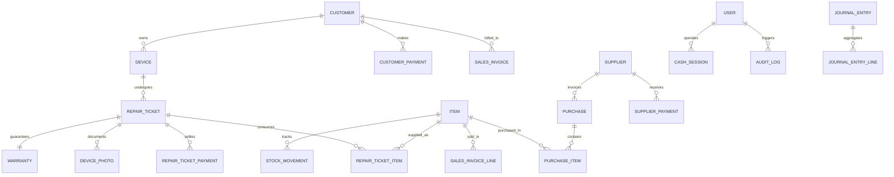

<div align="center">

# 📱 MRMS — Mobile Repair Management System
### *Enterprise Desktop ERP, Point-of-Sale (POS) & Service Workshop Management System*

[](https://dotnet.microsoft.com/)
[](https://learn.microsoft.com/dotnet/csharp/)
[](https://learn.microsoft.com/dotnet/desktop/wpf/)
[](https://blog.cleancoder.com/uncle-bob/2012/08/13/the-clean-architecture.html)
[](#-testing--quality-assurance)
[](https://www.microsoft.com/sql-server)
[](LICENSE)

<br/>

**MRMS** is a full-featured, enterprise-grade desktop ERP, Point-of-Sale (POS), and workshop management system built for mobile phone and electronics repair businesses. Engineered with **.NET 10**, **WPF**, and **Clean Architecture**, it orchestrates the entire operational lifecycle: from hardware intake and IMEI tracking to technician job cards, inventory valuation, multi-line POS billing, cash drawer shift reconciliation, supplier payables, and automated double-entry financial reporting.

[Key Features](#-key-features) • [Architecture](#-system-architecture) • [Tech Stack](#-technology-stack) • [Database Schema](#-database-schema--domain-model) • [Getting Started](#-getting-started) • [Testing](#-testing--quality-assurance) • [CV & Portfolio Guide](CV_SHOWCASE.md)

</div>

---

## 📌 Executive Summary

Running an electronics service center involves complex operational challenges: preventing device fraud through hardware IMEI validation, managing multi-stage hardware repair workflows, tracking consumption of physical spare parts versus billable labor, handling customer debt and partial payments, balancing daily cash drawers with blind drop counts, and tracking supplier payables.

**MRMS** provides a unified, high-performance native Windows desktop application with zero external cloud dependencies. It delivers enterprise capabilities with a clean, responsive user experience featuring native Right-to-Left (RTL) Arabic typography and localized multi-language support.

---

## 🚀 Key Features

### 🛠️ 1. Service Workshop & Repair Lifecycle
* **Intake Wizard & IMEI Validation:** Single-screen device intake workflow with real-time duplicate IMEI detection, existing customer auto-matching, condition assessment, and estimated cost tracking.
* **7-Stage Workflow Pipeline:** Visual ticket tracking through standard operational stages:
  $$\text{Received} \longrightarrow \text{Under Inspection} \longrightarrow \text{Waiting for Parts} \longrightarrow \text{In Repair} \longrightarrow \text{Repaired} \longrightarrow \text{Delivered} \ (\text{or} \ \text{Cancelled})$$
* **Interactive Kanban Board & DataGrid:** Drag-and-drop / single-click progression with color-coded status badges, technician assignment, and priority filters.
* **Visual Condition Documentation:** Before/After device photo capture and file attachments for dispute prevention.
* **Warranty Management:** Configurable warranty duration with automated expiration calculation and warranty certificate generation.
* **Print & Notification Integration:** Thermal receipt generation (80mm POS format) and automated WhatsApp notification templates for completed repairs.
* **Device Ownership Transfer:** Complete audit trail of device ownership transfers between customers with historical repair preservation.

### 💳 2. Point of Sale (POS) & Invoicing
* **Multi-Line Sales Invoicing:** High-speed POS billing supporting barcode scanning, instant search, and line-item quantity/discount adjustments.
* **Accounts Receivable (AR) & Customer Debt:** Support for cash and credit (*آجل*) sales with per-customer debt limits, payment schedules, and running ledger statements.
* **Instant Profitability Insights:** Real-time margin and gross profit calculation per transaction (permission-restricted to Store Owners / Managers).
* **Return & Refund Processing:** Integrated item return workflow with automated stock restoration and cashbook adjustment.

### 💵 3. Cash Register & Shift Control (CashSession)
* **Shift Lifecycle Management:** Formal shift opening with starting cash float verification and technician/cashier handover.
* **Real-Time Cash Tracking:** Consolidated aggregation of cash repair collections, POS sales revenue, supplier payouts, and operating expenses.
* **Blind Drop Reconciliation:** Cashiers perform a blind physical cash count at shift closing. The system computes discrepancies (overage / shortage) automatically.
* **Z-Report & Shift Audit:** Comprehensive end-of-shift closing reports with an immutable historical archive.

### 📦 4. Inventory & Warehouse Management
* **Multi-Tier Product Catalog:** Unified inventory engine supporting:
  * **Retail Accessories:** Tracked physical items with retail pricing.
  * **Spare Parts:** Internal parts consumed directly inside repair tickets.
  * **Intangible Services:** Billable labor and software services without physical stock counts.
* **Stock Movement Auditing:** Immutable movement logging (`Purchase`, `Sale`, `RepairConsumption`, `CustomerReturn`, `SupplierReturn`, `Damaged`, `Adjustment`).
* **Low-Stock Intelligence:** Automated reorder threshold alerts and visual status indicators.
* **Physical Stock Count Reconciliation:** Periodic inventory counting tool to reconcile on-hand quantities against physical shelf stock with discrepancy logging.

### 🚚 5. Procurement & Accounts Payable (AP)
* **Supplier Directory & Ledgers:** Vendor profile management, contact directories, and historical purchase tracking.
* **Multi-Line Purchase Invoices:** Purchase order receipt with line-item cost tracking and automatic stock increments.
* **Supplier Payment Vouchers:** Cash/deferred payment vouchers with automated debt deduction and statement of account generation.

### 📊 6. Accounting & Business Intelligence
* **Automated Double-Entry Accounting:** Auto-generated balanced journal entries (`JournalEntry` & `JournalEntryLine`) for sales, purchases, payments, and expenses.
* **Financial Statements:** Instant generation of General Ledger, Trial Balance, and Income Statement (Profit & Loss / P&L).
* **Operating Expense Tracking:** Multi-category expense recording (Rent, Utilities, Payroll, Maintenance).
* **Interactive Visual Analytics:** Rich time-series charts, monthly revenue trends, and category distribution powered by **LiveChartsCore (SkiaSharp)**.

### 🔐 7. Security, RBAC & Governance
* **Role-Based Access Control (RBAC):** Tailored views and permissions for **Owner**, **Manager**, **Technician**, and **Receptionist**.
* **Financial Privacy:** Sensitive financial metrics (margins, net profit, supplier debt, cash balance) are automatically redacted for non-owner roles.
* **Cryptographic Security:** Salted SHA-256 / PBKDF2 password hashing with mandatory password change on first login.
* **Immutable Audit Trail:** Comprehensive event logging (`AuditLog`) tracking sensitive operations, price overrides, ticket voids, and user actions.
* **Automated Backup & Disaster Recovery:** Integrated backup scheduler supporting both SQL Server (`.bak`) and SQLite file backups.

### 🌐 8. Native RTL UI & Modern Styling
* **Bi-Directional Support:** Built from the ground up for native Right-to-Left (RTL) Arabic layout and typography using the **Cairo** font family.
* **Enterprise Localization:** Resource-based localization (`.resx`) architecture ready for multi-lingual deployments.

---

## 🏛️ System Architecture

MRMS adheres strictly to **Clean Architecture** (Onion Architecture) principles, decoupling domain entities and business rules from user interfaces and data access frameworks.

```
                      ┌────────────────────────────────────────┐
                      │                MRMS.UI                 │
                      │  (WPF, XAML, MVVM, LiveCharts, Cairo)  │
                      └───────────────────┬────────────────────┘
                                          │ references
                                          ▼
                      ┌────────────────────────────────────────┐
                      │            MRMS.Application            │
                      │  (Services, DTOs, Security, Validation)│
                      └───────────┬────────────────┬───────────┘
                                  │                │
                       references │                │ references
                                  ▼                ▼
         ┌────────────────────────────────┐   ┌────────────────────────────────┐
         │           MRMS.Core            │   │      MRMS.Infrastructure       │
         │ (Entities, Enums, Interfaces)  │◄──┤ (EF Core 10, SQL Server/SQLite,│
         │   ** Pure Domain Layer **      │   │  Repositories, UnitOfWork)     │
         └────────────────────────────────┘   └────────────────────────────────┘
```

### Architectural Highlights

1. **Pure Domain Model (`MRMS.Core`):**
   * Contains POCO domain entities, domain enums, and repository abstractions (`IRepository<T>`, `IUnitOfWork`).
   * **Zero third-party dependencies** — completely isolated from EF Core, WPF, or logging frameworks.

2. **Orchestrated Business Logic (`MRMS.Application`):**
   * Encapsulates all transactional use cases (27 specialized services including `RepairTicketService`, `SaleService`, `CashSessionService`, `InventoryService`).
   * Utilizes C# records for immutable Data Transfer Objects (DTOs).
   * Cross-cutting concerns: RBAC permission verification, current user resolution, and security validation.

3. **Data Access & Infrastructure (`MRMS.Infrastructure`):**
   * Built on **Entity Framework Core 10** with Fluent API mapping and explicit Foreign Key cascade rules.
   * **Dual Database Engine Support:**
     * **Microsoft SQL Server:** Enterprise client-server mode for networked workshops with multiple concurrent cashier/technician terminals.
     * **SQLite:** Zero-configuration, file-based embedded mode for portable, single-PC deployments.
   * Generic Repository & Unit of Work patterns ensuring transactional consistency across multi-entity operations.
   * `Scoped` DbContext lifetime resolution to prevent change-tracker divergence across collaborative services.

4. **Modern MVVM Presentation (`MRMS.UI`):**
   * Implements MVVM using **CommunityToolkit.Mvvm** source generators (`[ObservableProperty]`, `[RelayCommand]`), reducing boilerplate code by 70%.
   * Navigation mediated by a decoupled `AppNavigationService` supporting parameter passing between views.
   * Structured diagnostic logging via **Serilog** rolling daily file sinks.

---

## 🗄️ Database Schema & Domain Model

The underlying relational schema consists of 22 core business entities designed for high data integrity, strict referential constraints, and zero data loss.



---

## 💻 Technology Stack

| Layer | Technology | Version | Purpose & Rationale |
|---|---|---|---|
| **Runtime** | .NET | `10.0 LTS` | High performance, cross-version runtime optimizations, modern C# 13 language features |
| **UI Framework** | WPF (Windows Presentation Foundation) | `.NET 10 Windows` | Native Windows rendering, hardware-accelerated XAML, high-DPI scaling, rich printing subsystem |
| **MVVM Toolkit** | CommunityToolkit.Mvvm | `8.4.2` | Roslyn source generators for observable properties and relay commands without runtime reflection overhead |
| **ORM / Data Access** | Entity Framework Core | `10.0.8` | Code-First migrations, Linq-to-Entities, fluent relationship configuration, Change Tracking |
| **Primary Database** | Microsoft SQL Server | `2022+ / 2025 Express` | Enterprise relational database for multi-user, multi-terminal shop networks |
| **Portable Database** | SQLite | `3.x` via EF Core | Self-contained, portable, zero-configuration embedded storage |
| **Data Visualization** | LiveChartsCore (SkiaSharp) | `2.0.0-rc5` | Smooth, hardware-accelerated time-series charts, financial distribution graphs, and trend analysis |
| **Structured Logging** | Serilog + Sinks.File | `4.3.1` | Diagnostic rolling-file logging with structured JSON metadata for post-mortem issue resolution |
| **Testing Framework** | xUnit | `2.9.3` | Modern, parallel test runner for unit and integration testing |
| **Mocking & Assertions**| Moq + FluentAssertions | `4.20.72` / `8.1.0` | Expressive behavior verification and fluent, readable test assertions |
| **Typography** | Google Fonts (Cairo) | Font Weights 400–800 | High-readability Arabic typography tailored for business software and data tables |

---

## 🧪 Testing & Quality Assurance

MRMS features a comprehensive suite of **128 unit tests** validating core business invariants, edge cases, financial calculations, and state machines.

```powershell
# Run the complete automated test suite
dotnet test MRMS.Tests/MRMS.Tests.csproj
```

```
Test run for MRMS.Tests.dll (.NETCoreApp,Version=v10.0)
Passed!  - Failed: 0, Passed: 128, Skipped: 0, Total: 128, Duration: 2.1 s
```

### Test Coverage Highlights
* **Authentication & Authorization:** Credential verification, salt verification, PBKDF2 hashing, role permission matrix.
* **Repair State Machine:** Status progression restrictions, terminal status protection, warranty automatic issuance on ticket delivery.
* **Financial Calculations:** Sales invoice line subtotal, customer balance debit/credit, supplier payment deduction, profit margin derivation.
* **Cash Register Balancing:** Float calculation, mid-shift payouts, blind-drop discrepancy detection (overage/shortage).
* **Inventory Constraints:** Stock reservation, negative-stock prevention, service item bypass, movement type auditing.

---

## ⚡ Getting Started

### Prerequisites
* Windows 10 (Build 19041+) or Windows 11 (64-bit)
* [.NET 10.0 SDK](https://dotnet.microsoft.com/download) installed
* [Git](https://git-scm.com/downloads) installed
* *(Optional)* SQL Server 2022/2025 Express for networked mode (SQLite is enabled out-of-the-box by default)

### 1. Clone & Build
```powershell
# Clone the repository
git clone https://github.com/Abd-Alrahman-Saed/Mobile-Repair-Management-System---MRMS.git
cd "Mobile-Repair-Management-System---MRMS"

# Restore NuGet dependencies
dotnet restore MRMS.slnx

# Build the complete solution
dotnet build MRMS.slnx --configuration Release
```

### 2. Run Tests
```powershell
dotnet test MRMS.Tests/MRMS.Tests.csproj
```

### 3. Launch the Application
```powershell
dotnet run --project MRMS.UI/MRMS.UI.csproj
```

### 4. Default Credentials (First Login)
On first launch, the database is automatically created and seeded with an initial administrative user:
* **Username:** `owner`
* **Password:** `owner`

*(The system will prompt you to set a secure password upon your first successful login).*

---

## ⚙️ Configuration & Database Selection

MRMS stores connection settings in `%AppData%\MRMS\connection-config.json` so that settings persist across application updates:

```json
{
  "Provider": "Sqlite",
  "ConnectionString": "Data Source=mrms.db"
}
```

To connect to a networked Microsoft SQL Server instance, update the configuration:

```json
{
  "Provider": "SqlServer",
  "ConnectionString": "Server=localhost\\SQLEXPRESS;Database=MRMS;Trusted_Connection=True;TrustServerCertificate=True;"
}
```

---

## 📁 Project Structure

```
Mobile-Repair-Management-System---MRMS/
├── MRMS.Core/                      # Domain Layer (Pure POCOs & Abstractions)
│   ├── Entities/                   # 22 Domain Entities (Customer, Ticket, Item, CashSession, etc.)
│   ├── Enums/                      # Domain Enums (TicketStatus, ItemType, MovementType, UserRole)
│   └── Interfaces/                 # Repository & Unit of Work Contracts (IRepository, IUnitOfWork)
│
├── MRMS.Application/               # Application Business Logic Layer
│   ├── DTOs/                       # Strongly-typed Data Transfer Records
│   ├── Interfaces/                 # 27 Service Interfaces (IRepairTicketService, ISaleService, etc.)
│   ├── Security/                   # PasswordHasher, CurrentUserService, PermissionService
│   └── Services/                   # Transactional Service Implementations
│
├── MRMS.Infrastructure/            # Data Access & External Infrastructure Layer
│   ├── Configuration/              # Database Configuration Provider
│   ├── Data/                       # EF Core AppDbContext with Fluent API Configurations
│   ├── Migrations/                 # EF Core SQL Server Migrations
│   ├── Repositories/               # Generic Repository and UnitOfWork Implementations
│   └── Services/                   # Database Seeder, SQL Server & SQLite Backup Providers
│
├── MRMS.UI/                        # Presentation Layer (WPF Desktop App)
│   ├── Converters/                 # XAML Value Converters (Status, Visibility, Currency)
│   ├── Resources/                  # Resource Dictionaries, Colors, Cairo Fonts, Strings.ar.resx
│   ├── Services/                   # AppNavigationService, NotificationService, PrintService
│   ├── ViewModels/                 # CommunityToolkit.Mvvm ViewModels
│   └── Views/                      # XAML Windows, Pages, Dialogs, and Print Previews
│
├── MRMS.Tests/                     # Automated Test Suite (xUnit + Moq + FluentAssertions)
│   └── Services/                   # 128 Unit Tests Covering All Application Services
│
├── Documentation/                  # System Requirements & Functional Specifications
├── CV_SHOWCASE.md                  # Comprehensive CV / Resume Showcase & Interview Guide
├── CONTRIBUTING.md                 # Contribution Guidelines & Architecture Rules
├── LICENSE                         # MIT License
└── MRMS.slnx                       # Visual Studio Solution File
```

---

## 💼 CV / Resume & Portfolio Integration

Using this project on your CV or LinkedIn? Check out **[CV_SHOWCASE.md](CV_SHOWCASE.md)** for:
* Ready-to-copy bullet points formatted with Google's X-Y-Z formula (`Accomplished [X] as measured by [Y], by doing [Z]`).
* 60-second elevator pitch and 3-minute technical architecture deep dive.
* Answers to common senior engineering interview questions regarding this codebase.
* Recommended GitHub repository topics and LinkedIn project description.

---

## 📄 License

This project is licensed under the [MIT License](LICENSE) — see the LICENSE file for details.

---

## 👨‍💻 Author

**Abd Alrahman Saed**  
*Full-Stack & .NET Software Engineer*  
* Email: [abdalrahman.saed.tech@gmail.com](mailto:abdalrahman.saed.tech@gmail.com)  
* GitHub: [@Abd-Alrahman-Saed](https://github.com/Abd-Alrahman-Saed)
